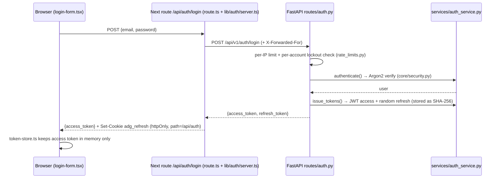

# AdGenius AI — Architecture & Code Guide

This guide explains how the code is organised, what every file is responsible for, and how
the files work together in each user-facing flow. Read Part 1 for the big picture, then Part 2
for the flow you care about. Part 3 is a file-by-file reference.

**Related docs:**
- [README](../README.md): how to run the app.
- [ROADMAP](ROADMAP.md): build history.
- [SECURITY](SECURITY.md): security controls and limits.
- [RAG_EVALUATION](RAG_EVALUATION.md): search quality measurements.

---

## Part 1 — The big picture

### 1.1 Running processes

```
                ┌──────────────────────────── Browser ────────────────────────────┐
                │  Next.js app (React)  http://localhost:3000                     │
                └──────┬──────────────────────────────────────────┬───────────────┘
      sign-in only     │ /api/auth/*  (same origin, cookie)        │ all data: Bearer token
                       ▼                                           │
          ┌──────────────────────────┐                             │
          │ Next.js route handlers   │ ── POST /api/v1/auth/* ──┐  │
          │ (BFF: keeps refresh      │                          ▼  ▼
          │  token in httpOnly cookie)│                 ┌───────────────────────┐
          └──────────────────────────┘                  │ FastAPI  :8000        │
                                                        │ app/main.py           │
                                                        └──┬────┬────┬──────┬───┘
                                    SQL (asyncpg)          │    │    │      │ enqueue jobs
                         ┌─────────────────────────────────┘    │    │      ▼
                         ▼                                      │    │   ┌────────────┐
                 ┌──────────────┐   vectors (search) ┌──────────┘    │   │   Redis    │
                 │ PostgreSQL   │                    ▼               │   │ queue,cache│
                 │ app tables + │             ┌────────────┐         │   │ rate limits│
                 │ langgraph    │             │  Qdrant    │         │   └─────┬──────┘
                 │ checkpoints  │             │  vectors   │         │         │ jobs
                 └──────▲───────┘             └─────▲──────┘         │         ▼
                        │                           │      ┌─────────┴──────────────────┐
                        └───────────────────────────┴──────┤ Celery workers             │
                                                           │  queue "default":  ingest, │
                                                           │    cleanup, maintenance    │
                                                           │  queue "campaigns": agents │
                                                           └──────┬──────────────┬──────┘
                                                                  ▼              ▼
                                                          Google Gemini      Tavily
                                                          (LLM)              (web search)
```

| Process | Started with | Job |
|---|---|---|
| Next.js | `npm run dev` (frontend/) | UI, plus the 3 auth route handlers |
| FastAPI | `uvicorn app.main:app` (backend/) | All REST endpoints and the live event stream |
| Celery worker `default` | `celery ... worker -Q default` | Document ingestion and cleanup, token purge |
| Celery worker `campaigns` | `celery ... worker -Q campaigns` | Multi-agent campaign workflow |
| Celery beat (optional) | `celery ... beat` | Schedules daily housekeeping |
| PostgreSQL / Redis / Qdrant | Windows service / start scripts | Storage |

### 1.2 Golden rule: slow work never runs inside an HTTP request

Uploading a document or generating a campaign:
1. writes a row with a waiting status (`pending` / `queued`),
2. puts a job on a Redis queue,
3. returns immediately (`201` / `202`).

A worker then does the work and updates the row. The UI watches progress: it polls for
documents, and uses Server-Sent Events (a one-way live stream from the server) for
campaign runs.

### 1.3 Backend layering

Every HTTP request passes through the same layers, and dependencies only point
**downwards**:

```
routes/       (app/api/v1/routes)  HTTP only: parse input, check auth, call a service, shape output
   │  uses  deps.py (current user, org role), rate_limits.py, schemas/ (request/response models)
   ▼
services/     (app/services)       business rules + transactions; raise AppError subclasses
   │
   ▼
models/       (app/models)         SQLAlchemy tables          db/ (engine, sessions, base classes)

Domain engines, called by services, agents and workers:
   ingestion/  rag/  research/  llm/  agents/  campaigns/  exports/
Infrastructure, used everywhere:
   core/  (config, security, errors, middleware, rate limiter, storage, logging, tracing)
```

- **Routes never contain business logic.**
- **Services never build HTTP responses.** They raise errors such as `NotFoundError`, and
  `core/exceptions.py` turns them into the standard error JSON.
- **Domain engines depend on interfaces, not vendors.** For example, `StructuredLLM`
  rather than Gemini directly, which is how tests swap in fakes (`tests/fakes.py`).

### 1.4 Frontend layering

```
app/**/page.tsx        route = a thin server component that reads params and renders one feature component
   ▼
components/<feature>/  the UI (client components); reads data only through query hooks
   ▼
lib/queries/*.ts       TanStack Query hooks: caching, refetching, mutations, cache invalidation
   ▼
lib/api/client.ts      typed fetch client generated from the backend OpenAPI schema
   ▼
lib/auth/token-store   attaches/refreshes the access token
```

---

## Part 2 — Flows: how the files work together

### 2.1 Every API request (the pipeline)

```
HTTP request
 → CORSMiddleware                core: allowed origins only (main.py)
 → RequestIDMiddleware           core/middleware.py: assigns X-Request-ID, puts it in every log line
 → SecurityHeadersMiddleware     core/middleware.py: nosniff, CSP, no-store, ...
 → BodySizeLimitMiddleware       core/middleware.py: 413 if the body is too big
 → router (api/v1/router.py) → route function
     dependencies resolved first (api/deps.py, api/rate_limits.py):
        get_db_session → one AsyncSession per request (db/session.py)
        get_current_user → decode JWT (core/security.py) → load User, must be active
        limit_by_user / limit_by_ip → Redis counter (core/rate_limit.py) → 429 if over
     body validated by a Pydantic schema (schemas/*.py) → 422 if invalid
     service call → returns a model → route converts it to a response schema
 → any AppError / HTTPException / crash → core/exceptions.py → {"error": {...}} envelope
```

**Tenant isolation** works the same way everywhere. A service loads a resource *through
the caller's memberships*, for example `brand_service.get_brand_for_user(session,
brand_id, user.id)`. If the user isn't a member of that organization, the result is
`NotFoundError` (404), so the resource's existence never leaks.

### 2.2 Authentication



- **Each API call:** `lib/api/client.ts` middleware calls `getAccessToken()`. If the
  token expires within 30 s, it first calls `POST /api/auth/refresh`.
- **Refresh:**
  - The route handler reads the cookie and calls `/api/v1/auth/refresh`.
  - `auth_service.rotate_refresh_token` marks the old token used and issues a new one in
    the same *family*.
  - Presenting an already-used token revokes the whole family (theft detection).
  - On the browser side, refresh is **single-flight**: parallel callers share one
    request, so the app never trips its own theft detection.
- **On a 401 response:** the client refreshes once and replays the request. If refresh
  fails, `token-store.ts` fires `adg:session-expired`. `auth-context.tsx` then clears the
  user, and `require-auth.tsx` redirects to `/login?next=...`.
- **Page load:** `auth-context.tsx` tries a refresh. The httpOnly cookie restores the
  session without the user signing in again.
- **Logout:** `/api/auth/logout` revokes the family server-side, then clears the cookie.
- **Housekeeping:** the `maintenance.purge_refresh_tokens` task deletes fully expired
  families once a day.

### 2.3 Workspaces and roles

| Step | Files |
|---|---|
| After login, `/` → `org-picker.tsx` reads `GET /auth/me` (user + memberships) and jumps to the last workspace (`lib/workspace.ts`) | `app/page.tsx`, `components/app/org-picker.tsx` |
| Create a workspace → `POST /organizations` → creator becomes **owner** | `create-org-form.tsx` → `routes/organizations.py` → `organization_service.create_organization` |
| Workspace pages render inside `workspace-shell.tsx` (sidebar, switcher) | `app/orgs/[orgId]/layout.tsx` |
| Members: add / change role / remove; the rules (only owners manage owners, at least one owner must remain) live in `organization_service`, and the UI mirrors them (`members-settings.tsx`, `canManage()` in `lib/queries/organizations.ts`) | `routes/organizations.py`, `services/organization_service.py` |
| Endpoints that need a role use `OrgMemberDep` / `OrgAdminDep` from `api/deps.py` → `require_membership` | `api/deps.py` |

### 2.4 Brands

`brand-list.tsx` / `create-brand-dialog.tsx` → `lib/queries/brands.ts` →
`routes/brands.py` → `brand_service.py` → `models/brand.py`.

- **Profile storage:** the profile (voice, colours, competitors, restrictions...) is
  stored in JSONB columns and validated by `schemas/brand.py`. The form
  `brand-profile-form.tsx` mirrors the same rules with Zod.
- **Delete:** a *soft delete*. It sets `deleted_at` and queues `documents.cleanup` to
  remove the brand's files and vectors.

### 2.5 Document upload → ingestion

```mermaid
sequenceDiagram
  participant UI as documents-panel.tsx
  participant R as routes/documents.py
  participant DS as services/document_service.py
  participant Q as Redis queue "default"
  participant W as worker/tasks.py → ingestion/pipeline.py
  UI->>R: POST /brands/{id}/documents (multipart)
  R->>DS: upload_document()
  DS->>DS: stream to temp file with size limit + SHA-256; ingestion/validation.py checks extension AND magic bytes
  DS->>DS: storage.save() under random key (core/storage.py); row status=pending
  R-->>UI: 201 (document)
  R->>Q: (after response) dispatch.enqueue_ingestion()
  Q->>W: documents.ingest(document_id)
  W->>W: status=processing → extractors.py → cleaning.py → chunking.py (800 tok / 120 overlap)
  W->>W: embeddings.py (dense jina + sparse BM25, local) → vector_store.py upsert to Qdrant
  W->>W: status=indexed (or failed with a readable message)
  UI->>R: polls GET /brands/{id}/documents while any are pending/processing (lib/queries/documents.ts)
```

- **Idempotent:** a re-delivered job skips documents that are already indexed. Qdrant
  point IDs are deterministic (`vector_store.point_id`), so a re-run overwrites instead
  of duplicating.
- **Permanent vs temporary errors:** a broken file is marked `failed` and not retried.
  An infrastructure error (Qdrant down) is re-raised, and Celery retries with backoff.
- **Delete / reindex:** delete sets status `deleted` and queues `documents.cleanup`
  (remove vectors and file). Reindex resets to `pending` and re-queues with `force=True`.

### 2.6 Knowledge search and Q&A (RAG)

`POST /brands/{id}/knowledge/search` or `/ask` → `routes/knowledge.py` → `rag/service.py`
(`RagService`):

1. **`query_rewriter.py`**: Gemini turns the question into up to 3 extra search queries
   (on by default for `/ask` and the agents, off for `/search`).
2. **`retriever.py`**: for each query, a dense search and a BM25 search in Qdrant, fused
   *inside Qdrant* with Reciprocal Rank Fusion (RRF). Everything is filtered by
   `organization_id` + `brand_id` (`scope_filter`).
3. **`RagService._only_live_documents`**: drops chunks whose document is no longer
   `indexed` in Postgres.
4. **`reranker.py`** (optional, off by default; see RAG_EVALUATION.md).
5. **`/ask` only:**
   - `context.py` picks the top chunks within a token budget and numbers them `[1]..[n]`;
   - `generator.py` makes Gemini answer **only from those sources**;
   - citations to numbers that weren't supplied are removed.

`scope_for_brand()` builds the filter. The Brand Research agent uses the same
`RagService`, wrapped as `BrandKnowledge` in `agents/deps.py`.

### 2.7 Competitor research (live web)

`routes/research.py` (standalone endpoint) and `agents/nodes/competitor_analyst.py` (inside
a campaign) both call `research/competitor.py` → `CompetitorResearchService.research()`:

1. **Plan** queries with Gemini. The plan is cached in Redis, keyed by brand profile and
   brief focus, so re-runs reuse the same queries. Fallback template queries are used if
   the LLM fails.
2. **Search** in parallel, capped by the credit budget:
   - `web_search.py` → Tavily, wrapped by `cache.py` (Redis, 24 h);
   - `sanitize.py` cleans URLs and snippets;
   - trend queries only fetch pages from the past year.
3. **Rank and number the evidence** `E1..En`, then have Gemini write a report where every
   claim must cite evidence IDs.
4. **`_validated`** drops every claim that cites no real evidence and counts what it
   removed.

### 2.8 Campaign generation (the core flow)

#### a) Create and queue

```
campaign-wizard.tsx (4 steps, Zod validation)
  → POST /campaigns                         routes/campaigns.py → campaign_service.create_campaign
  → POST /campaigns/{id}/generate           → campaign_service.create_run
        creates CampaignRun v{n}: status=queued, frozen brief_snapshot + brand_snapshot
        → BackgroundTasks → worker/dispatch.enqueue_campaign_run → Redis queue "campaigns"
  → router.push(/orgs/.../runs/{runId})     → run-workspace.tsx
```

The snapshots mean that later edits to the brand or brief don't change a run that has
already started.

#### b) The worker drives the agent graph

`worker/tasks.py: execute_campaign_run_task` → `campaigns/executor.py: execute_run`. It
looks at **durable state** (not the task message) to decide what to do, so duplicate or
re-delivered jobs are harmless:

| State found | Action |
|---|---|
| workflow not started | `CampaignWorkflow.start()` |
| paused at approval + a decided, unapplied `Approval` row | `resume()` with that decision |
| paused, nothing decided yet | nothing to do; just sync the status |
| started but unfinished (crash) | `retry()` from the last checkpoint |
| run already finished | no-op |

The executor builds:
- `agents/runner.py: CampaignWorkflow`, which wraps the compiled graph;
- the dependencies, via `agents/factory.py: live_agent_deps` (Gemini LLM, RAG
  `BrandKnowledge`, competitor researcher);
- the PostgreSQL checkpointer `agents/checkpointer.py`, which saves graph state after
  every step into the `langgraph` schema.

#### c) The graph (`agents/graph.py`)

```
START → campaign_manager ─┬─► brand_research ──────┐
                          └─► competitor_research ─┴─► merge_research → creative_strategist
                                                                              │
              ┌───────────────────────────────────────────────────────────────┘
              ▼
       concept_approval  ── interrupt() ⏸  (job ends; run = awaiting_approval)
          │  approve → scriptwriter → visual_director → critic
          │  reject  → creative_strategist (new round, max 3 rounds)
          │  too many rejections → finalize (concepts_rejected)
          ▼
       critic ── score ≥ 80 ───────────────► finalize → END (completed)
              └─ score < 80 → revise → scriptwriter or visual_director (max 2 rounds)
                               after max rounds ──────► finalize (needs_review)
```

| Node | File | What it produces |
|---|---|---|
| campaign_manager | `nodes/manager.py` | `ExecutionPlan`: research questions, constraints, whether to run web research |
| brand_research | `nodes/brand_researcher.py` | answers the plan's questions from the brand's documents (RAG) |
| competitor_research | `nodes/competitor_analyst.py` | competitor report (failures *degrade* the run, they don't fail it) |
| merge_research | `nodes/flow.py` | joins the two parallel branches |
| creative_strategist | `nodes/strategist.py` | `ConceptSet` (3 concepts) |
| concept_approval | `nodes/approval.py` | pauses for a human; routes on the decision |
| scriptwriter / visual_director | `nodes/production.py` | `Script` (timed scenes) / `Storyboard` (shots + image prompts); `timing.py` makes the scene times add up exactly |
| critic | `nodes/critic.py` | scores 0–100 on several dimensions plus issues; `guardrail_issues()` deterministically flags banned phrases |
| revise / finalize | `nodes/flow.py` | route revisions; build the final campaign |

Supporting files:
- `state.py`: the shared state dict.
- `schemas.py`: every agent's input/output contract.
- `context.py`: shared prompt building blocks.
- `deps.py`: injected dependencies, plus the `@traced` decorator that records timing and
  status events per node.

#### d) Live progress

```
graph node finishes → runner._drive() → recorder.on_update()  (campaigns/recorder.py)
   → INSERT agent_runs (trace step) + campaign_outputs (new VERSION of that output); commit
                         │
GET /campaign-runs/{id}/events  (routes/campaign_runs.py: run_events)
   polls every 1 s → sends SSE "agent" (id = step sequence), "status", finally "end"
                         │
lib/sse.ts (fetch-based SSE, auto-reconnect with Last-Event-ID)
   → hooks/use-run-events.ts: "agent" → append step into the cached run (instant UI)
                              "status" → refetch run, outputs and evaluation
   → run-pipeline.tsx shows stages; tabs fill in as outputs appear
```

The client uses `fetch` instead of the browser's `EventSource` because `EventSource`
can't send the `Authorization` header.

#### e) Human approval

`concept-approval.tsx` → `POST /approvals/{id}/approve` (or `/reject` with feedback) →
`routes/campaign_runs.py`:
1. Records the decision on the `Approval` row.
2. Sets the run back to `queued` and enqueues the run again.
3. The executor finds a decided, unapplied approval and calls `resume()`; the graph
   continues from the checkpoint.

#### f) After the run

| Feature | UI | API → code |
|---|---|---|
| Evaluation dashboard | `evaluation-view.tsx`, `charts/bar-chart.tsx` | `GET /campaign-runs/{id}/evaluation-summary` → `analytics_service.evaluation_summary` |
| View any version of an output | `version-picker.tsx`, `research-view.tsx`, `concepts-view.tsx` | `GET /campaign-runs/{id}/outputs/{type}?version=` |
| Edit script / storyboard | `script-editor.tsx`, `storyboard-editor.tsx` | `PUT /campaign-runs/{id}/script\|storyboard` → `campaign_service.save_human_output` (new version, `source="human"`; only for finished runs) |
| PDF | Download button in `run-workspace.tsx` → `downloadRunPdf` | `GET /campaign-runs/{id}/export.pdf` → `exports/campaign_pdf.py` (latest edits overlaid, all text HTML-escaped) |
| Retry a failed run | Retry button | `POST /campaign-runs/{id}/retry` → `requeue_failed_run` → executor `retry()` from the checkpoint |
| Regenerate | Regenerate button | `POST /campaign-runs/{id}/regenerate` → new run v{n+1} from the campaign's *current* brief |

### 2.9 Dashboard

`app/orgs/[orgId]/dashboard/page.tsx` → `useDashboard` →
`GET /organizations/{id}/dashboard` → `routes/dashboard.py` → `analytics_service.organization_dashboard`. That function runs
aggregate SQL queries for totals, quality rates, recent campaigns, agent activity and
recent documents.

---

## Part 3 — File reference

### 3.1 Backend `backend/app/`

**Entry and infrastructure**

| File | Responsibility |
|---|---|
| `main.py` | App factory: settings, logging, tracing, middleware order, error handlers, routers; closes DB/Qdrant/Redis on shutdown |
| `core/config.py` | `Settings`: every env var, with validation and production guards; `get_settings()` (cached) |
| `core/security.py` | Argon2 hashing, JWT create/decode, refresh-token generation and hashing |
| `core/exceptions.py` | `AppError` family (400–503) and the global handlers producing the error envelope |
| `core/middleware.py` | Request-ID, security-headers and body-size middleware (plain ASGI, so SSE works) |
| `core/rate_limit.py` | `Limit`, Redis limiter (atomic Lua; fails open), in-memory limiter for tests |
| `core/storage.py` | Private file storage (`LocalFileStorage`), random keys, temp staging |
| `core/logging.py` | Log format, with the request ID on every line |
| `core/tracing.py` | Optional LangSmith tracing when `LANGSMITH_API_KEY` is set |
| `core/aio.py` | `run_async`: a SelectorEventLoop on Windows (needed by psycopg in workers) |
| `db/base.py` | `Base`, UUID primary-key and timestamp mixins |
| `db/session.py` | Async engine and `get_db_session` dependency |

**HTTP layer**

| File | Responsibility |
|---|---|
| `api/deps.py` | `get_current_user`, `require_org_role` → `CurrentUserDep`, `OrgMemberDep`, `OrgAdminDep` |
| `api/rate_limits.py` | All rate-limit policies; `client_ip` (trusted proxies); `limit_by_ip` / `limit_by_user` dependencies |
| `api/v1/router.py` | Mounts every route module under `/api/v1` |
| `routes/health.py` | `/health` (liveness), `/health/ready` (checks DB, Redis, Qdrant) |
| `routes/auth.py` | register, login (with lockout), refresh, logout, me, change-password |
| `routes/organizations.py` | Workspaces and members |
| `routes/brands.py` | Brand CRUD |
| `routes/documents.py` | Upload, list, get, delete, reindex |
| `routes/knowledge.py` | RAG search and ask |
| `routes/research.py` | Standalone competitor research |
| `routes/campaigns.py` | Campaign CRUD, generate, list runs |
| `routes/campaign_runs.py` | Run detail, SSE events, approvals, outputs, edits, evaluation, PDF, retry/regenerate |
| `routes/dashboard.py` | Organization dashboard |
| `schemas/*.py` | Pydantic request/response models: the API contract the frontend types are generated from |

**Business logic: `services/`**

| File | Responsibility |
|---|---|
| `auth_service.py` | Register, authenticate, issue/rotate/revoke tokens, change password, purge expired tokens |
| `organization_service.py` | Membership lookups (`require_membership`), role rules, member management |
| `brand_service.py` | Brand access through memberships, CRUD, soft delete |
| `document_service.py` | Validated streaming upload, listing, delete, reindex |
| `campaign_service.py` | Campaigns, versioned runs, approvals, outputs, human edits |
| `analytics_service.py` | Evaluation summary and dashboard queries |

**Data: `models/`** (tables in brackets)

| File | Tables |
|---|---|
| `user.py`, `organization.py`, `membership.py`, `refresh_token.py` | `users`, `organizations`, `memberships` (role: owner/admin/member), `refresh_tokens` |
| `brand.py` | `brands` |
| `document.py` | `brand_documents` (status: pending → processing → indexed / failed / deleted) |
| `campaign.py` | `campaigns`, `campaign_runs`, `agent_runs` (trace steps), `campaign_outputs` (versioned), `approvals` |

**Engines**

| Folder / file | Responsibility |
|---|---|
| `ingestion/validation.py` | Filename sanitising; extension and magic-byte agreement |
| `ingestion/extractors.py` | PDF (PyMuPDF), DOCX, TXT, CSV → text with page numbers |
| `ingestion/cleaning.py` | Normalise whitespace and unicode |
| `ingestion/chunking.py` | Token-aware splitting (LangChain splitter, tiktoken counts) |
| `ingestion/embeddings.py` | FastEmbed dense and sparse models (local CPU) |
| `ingestion/vector_store.py` | Qdrant collection and indexes, upsert/delete, deterministic point IDs |
| `ingestion/pipeline.py` | `ingest_document`: orchestrates the above with status updates |
| `rag/service.py` | `RagService.search()` / `.answer()` (entry point) |
| `rag/query_rewriter.py`, `retriever.py`, `reranker.py`, `context.py`, `generator.py` | The RAG steps described in §2.6 |
| `rag/types.py`, `rag/evaluation.py` | Internal types; retrieval metrics (hit@k, recall, MRR, nDCG) |
| `llm/client.py` | `StructuredLLM` interface; `GeminiLLM` (schema-validated output, fallback model, retries, timeout) |
| `research/web_search.py`, `cache.py`, `sanitize.py`, `competitor.py` | The web-research steps described in §2.7 |
| `agents/*` | The workflow described in §2.8c |
| `campaigns/executor.py`, `recorder.py` | Run lifecycle (§2.8b) and progress persistence (§2.8d) |
| `exports/campaign_pdf.py` | Escaped HTML → PDF (PyMuPDF Story) |

**Background jobs: `worker/`**

| File | Responsibility |
|---|---|
| `celery_app.py` | Celery config: queues (`default`, `campaigns`), routing, late acks, time limits, beat schedule |
| `tasks.py` | `documents.ingest`, `documents.cleanup`, `campaigns.execute`, `maintenance.purge_refresh_tokens` |
| `dispatch.py` | API-side `enqueue_*` helpers; never raise (a failed enqueue leaves the row waiting) |

**Scripts: `backend/scripts/`**

| File | Use |
|---|---|
| `run_campaign.py` | CLI to start/resume/retry/show a workflow without the UI |
| `eval_retrieval.py` | Compare search configurations on the labelled dataset in `evals/` |
| `export_openapi.py` | Writes `frontend/src/lib/api/openapi.json` (then `npm run gen:api`) |

### 3.2 Frontend `frontend/src/`

**Routes: `app/`**

| File | Page |
|---|---|
| `layout.tsx`, `providers.tsx` | Root HTML, theme, React Query client (retry policy), auth provider, toasts |
| `page.tsx` | `/`: workspace picker / redirect |
| `(auth)/login`, `(auth)/register` | Sign-in and sign-up |
| `api/auth/{login,refresh,logout}/route.ts` | BFF route handlers: the only code that touches the refresh cookie |
| `orgs/layout.tsx` | Suspense + `RequireAuth` guard for all workspace pages |
| `orgs/[orgId]/layout.tsx` | `WorkspaceShell` (sidebar, workspace switcher) |
| `orgs/[orgId]/dashboard` | Dashboard |
| `orgs/[orgId]/brands`, `brands/[brandId]` | Brand list; brand detail (profile + knowledge base tabs) |
| `orgs/[orgId]/campaigns`, `new`, `[campaignId]`, `[campaignId]/edit`, `[campaignId]/runs/[runId]` | Campaign list, wizard, campaign history, edit brief, run workspace |
| `orgs/[orgId]/settings` | Account, workspace, members |

**Components: `components/`**

| Folder | Contents |
|---|---|
| `app/` | Shell, org picker/creator, page header, empty state, stat card, status badge, confirm dialog, logo |
| `auth/` | `login-form.tsx`, `require-auth.tsx` |
| `brands/` | List, create dialog, detail, profile form, documents panel (upload, status, reindex, delete) |
| `campaigns/` | `campaign-wizard.tsx` (create/edit + start), `campaign-list.tsx`, `campaign-detail.tsx` (run history) |
| `runs/` | `run-workspace.tsx` (the run page), `run-pipeline.tsx` (agent stages), `concept-approval.tsx` / `concept-card.tsx`, `concepts-view.tsx`, `research-view.tsx`, `script-editor.tsx`, `storyboard-editor.tsx`, `version-picker.tsx`, `evaluation-view.tsx` |
| `settings/` | Account, workspace, members |
| `charts/bar-chart.tsx` | Accessible bar chart with a table view |
| `ui/` | shadcn/ui primitives (button, card, dialog, ...) |

**Logic: `lib/` and `hooks/`**

| File | Responsibility |
|---|---|
| `lib/config.ts` | `API_URL` (browser) / `SERVER_API_URL` (route handlers) |
| `lib/api/client.ts` | Typed `openapi-fetch` client; auth middleware with one 401 retry; `unwrap()` |
| `lib/api/schema.d.ts`, `openapi.json` | Generated from the backend; don't edit by hand |
| `lib/api/types.ts`, `errors.ts` | Friendly type aliases and status lists; `ApiError` / `errorMessage` |
| `lib/auth/token-store.ts` | In-memory access token, single-flight refresh, session-expired event |
| `lib/auth/auth-context.tsx` | `useAuth()`: current user, login, logout, session restore |
| `lib/auth/server.ts` | Route-handler helpers: cookie, same-origin check, backend call (forwards client IP), error passthrough |
| `lib/queries/*.ts` | One file per resource: query keys, `useX` reads, mutations with cache invalidation |
| `lib/sse.ts`, `hooks/use-run-events.ts` | Live run updates (§2.8d) |
| `lib/format.ts`, `lib/workspace.ts`, `lib/utils.ts` | Formatting, last-workspace memory, `cn()` class helper |

### 3.3 Tests

| Location | What it covers |
|---|---|
| `backend/tests/conftest.py` | Test DB migrated from scratch each session; each test runs in a rolled-back transaction; HTTP client with dependency overrides (DB, storage, rate limiter); job queue replaced by a recorder |
| `backend/tests/fakes.py` | `FakeLLM`, `FakeSearchProvider`, fake embedder/vector store: no network in tests |
| `test_auth.py`, `test_security.py`, `test_organizations.py`, `test_brands.py` | Auth, tokens, roles, isolation |
| `test_documents_api.py`, `test_ingestion_*.py`, `test_rag*.py`, `test_web_research.py` | Uploads, the pipeline, retrieval, research |
| `test_agents.py`, `test_campaigns.py`, `test_output_editing.py`, `test_exports_analytics.py` | Workflow paths (approve/reject/revise/fail/retry), runs API, edits, PDF and analytics |
| `test_hardening.py` | Rate limits, lockout, headers, body limits, config guards, queues, token purge |
| `frontend/e2e/smoke.spec.ts` | Browser: register → workspace → brand → upload → dashboard → sign out |
| `frontend/e2e/campaign.spec.ts` | Browser, real AI: brief → live agents → approve → evaluation → edit → PDF |

---

## Part 4 — State machines

```
Document:     pending → processing → indexed
                              └────→ failed          (any) → deleted
                       reindex: indexed/failed → pending

Campaign run: queued → running → awaiting_approval → (approve) queued → running → completed
                                                                               └→ needs_review
                          (too many rejections) → concepts_rejected
              any running step can → failed → (retry) queued → running ...
              completed / needs_review / failed: "regenerate" creates a NEW run (version + 1)
```

## Part 5 — Common changes: where to touch

| You want to... | Touch |
|---|---|
| Add an API endpoint | `schemas/` (models) → `services/` (logic) → `routes/` (endpoint, deps, rate limit if expensive) → test in `backend/tests/` → `python -m scripts.export_openapi` + `npm run gen:api` → `lib/queries/` hook → component |
| Add a database column | `models/` → `alembic revision --autogenerate` (review it!) → `alembic upgrade head`; `test_migrations_match_models` catches mismatches |
| Change an agent's behaviour | Its file in `agents/nodes/` (prompt) and/or `agents/schemas.py` (output contract); tests in `test_agents.py` use `FakeLLM` |
| Add an agent | New `nodes/<name>.py` with `make_<name>(deps)` → register and wire edges in `agents/graph.py` → add its output to `recorder.NODE_OUTPUTS` (and an `OutputType` + migration) → add the stage in `run-pipeline.tsx` |
| Tune limits | Rate limits: `api/rate_limits.py`. Workflow thresholds, RAG depth, budgets: `core/config.py` / `.env` |
| Add a background job | Task in `worker/tasks.py` (named `area.action`) → enqueue helper in `worker/dispatch.py` → route to a queue in `celery_app.py` if it isn't short |
